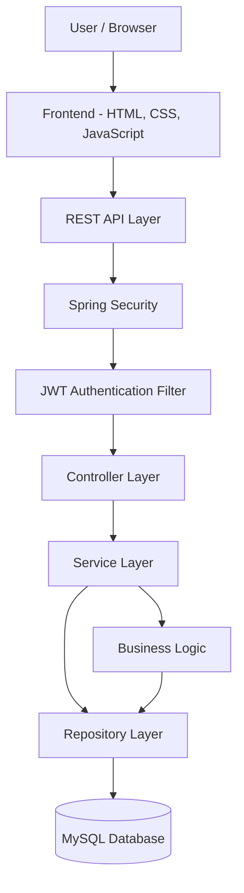
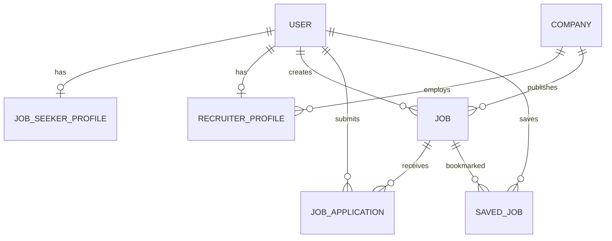
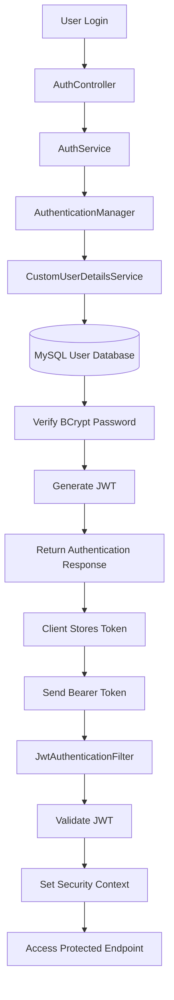

# JobPortal – Full-Stack Job Portal Application

A role-based Job Portal application designed to connect job seekers with recruiters through a centralized platform. The project uses **Java, Spring Boot, Spring Security, JWT Authentication, Spring Data JPA and MySQL** for backend development, with **HTML, CSS and JavaScript** for the frontend.

The application is designed around three primary user roles: Job Seeker, Recruiter and Admin.

---

## Table of Contents

- [Project Overview](#-project-overview)
- [Key Features](#-key-features)
- [Technology Stack](#-technology-stack)
- [System Architecture](#-system-architecture)
- [Project Structure](#-project-structure)
- [User Roles](#-user-roles)
- [Database Design](#-database-design)
- [Authentication and Authorization](#-authentication-and-authorization)
- [API Documentation](#-api-documentation)
- [Getting Started](#-getting-started)
- [Environment Configuration](#-environment-configuration)
- [Running the Application](#-running-the-application)
- [Security Practices](#-security-practices)
- [Future Enhancements](#-future-enhancements)
- [Author](#-author)

---

## 📌 Project Overview

JobPortal is a full-stack web application intended to simplify the recruitment process by providing separate access and functionality for job seekers, recruiters and administrators.

Job seekers can create accounts, maintain their professional profiles and explore employment opportunities. Recruiters can manage company information and create job listings. Administrators have a designated role for platform-level management.

The backend follows a layered architecture using Spring Boot, with Spring Security handling authentication and authorization and JWT providing stateless authentication.

### Project Objectives

- Provide a centralized platform for job opportunities.
- Implement secure user registration and login.
- Support role-based access control.
- Manage users, companies, jobs and applications.
- Maintain structured relationships using MySQL and JPA.
- Provide REST API capabilities for frontend-backend communication.

---

## ✨ Key Features

### 1. User Authentication

- User registration with name, email, password and role.
- User login using email and password.
- JWT token generation after successful authentication.
- Password hashing using BCrypt.
- Current authenticated user information.
- Password change functionality.

### 2. Role-Based Access Control

The application defines three user roles:

- `JOB_SEEKER`
- `RECRUITER`
- `ADMIN`

Spring Security uses role-based authorities to restrict access to protected API routes.

### 3. Job Management Foundation

The backend includes job-related entities, repositories, DTOs and service-layer operations.

Designed capabilities include:

- Creating job listings.
- Updating job information.
- Deleting job listings.
- Retrieving job details.
- Listing jobs with pagination.
- Retrieving jobs associated with recruiters.

### 4. User and Company Management

The data model supports:

- User accounts.
- Job seeker profiles.
- Recruiter profiles.
- Company information.
- Relationships between recruiters and companies.

### 5. Job Application Management Foundation

The application data model includes:

- Job applications.
- Job seeker associations.
- Resume path storage.
- Cover letters.
- Application status.
- Application timestamps.
- Duplicate application prevention at the database level through a unique job-seeker/job constraint.

### 6. Security

- Stateless authentication using JWT.
- BCrypt password encoding.
- Custom Spring Security authentication filter.
- Custom UserDetails implementation.
- Role-based authorization.
- Protected API access.

---

## 🛠️ Technology Stack

| Category | Technologies |
|---|---|
| Backend Language | Java 25 (LTS) |
| Backend Framework | Spring Boot |
| REST API | Spring Web |
| Security | Spring Security |
| Authentication | JSON Web Token (JWT) |
| ORM | Spring Data JPA / Hibernate |
| Database | MySQL 8+ |
| Password Hashing | BCrypt |
| Build Tool | Apache Maven |
| Frontend | HTML5, CSS3, JavaScript |
| Object Mapping | ModelMapper |
| Monitoring | Spring Boot Actuator |
| IDE | IntelliJ IDEA |
| Version Control | Git and GitHub |

---

## 🏗️ System Architecture

The application follows a layered backend architecture.



### Backend Architecture

| Layer | Responsibility |
|---|---|
| Controller | Handles HTTP requests and responses |
| Service | Contains application business logic |
| Repository | Performs database operations |
| Entity | Represents database tables |
| DTO | Transfers data between API layers |
| Security | Handles authentication and authorization |
| Config | Contains application configuration |

---

## 📁 Project Structure

```text
job-search-application/
│
├── backend/
│   │
│   ├── src/
│   │   └── main/
│   │       │
│   │       ├── java/
│   │       │   └── com/
│   │       │       └── jobportal/
│   │       │           │
│   │       │           ├── config/
│   │       │           │   └── SecurityConfig.java
│   │       │           │
│   │       │           ├── controller/
│   │       │           │   └── AuthController.java
│   │       │           │
│   │       │           ├── dto/
│   │       │           │   ├── AuthResponse.java
│   │       │           │   ├── LoginRequest.java
│   │       │           │   ├── RegisterRequest.java
│   │       │           │   ├── UserInfoResponse.java
│   │       │           │   ├── ChangePasswordRequest.java
│   │       │           │   ├── JobCreateRequest.java
│   │       │           │   └── JobResponse.java
│   │       │           │
│   │       │           ├── entity/
│   │       │           │   ├── User.java
│   │       │           │   ├── Role.java
│   │       │           │   ├── Company.java
│   │       │           │   ├── Job.java
│   │       │           │   ├── JobApplication.java
│   │       │           │   ├── JobSeekerProfile.java
│   │       │           │   ├── RecruiterProfile.java
│   │       │           │   └── SavedJob.java
│   │       │           │
│   │       │           ├── repository/
│   │       │           │   ├── UserRepository.java
│   │       │           │   ├── CompanyRepository.java
│   │       │           │   ├── JobRepository.java
│   │       │           │   ├── JobApplicationRepository.java
│   │       │           │   ├── JobSeekerProfileRepository.java
│   │       │           │   ├── RecruiterProfileRepository.java
│   │       │           │   └── SavedJobRepository.java
│   │       │           │
│   │       │           ├── security/
│   │       │           │   ├── CustomUserDetails.java
│   │       │           │   ├── JwtAuthenticationFilter.java
│   │       │           │   └── JwtService.java
│   │       │           │
│   │       │           ├── service/
│   │       │           │   ├── AuthService.java
│   │       │           │   ├── JobService.java
│   │       │           │   └── CustomUserDetailsServiceImpl.java
│   │       │           │
│   │       │           └── JobPortalApplication.java
│   │       │
│   │       └── resources/
│   │           └── application.properties
│   │
│   └── pom.xml
│
├── frontend/
│   ├── index.html
│   └── css/
│       └── style.css
│
├── .gitignore
└── README.md
```

---

## 👥 User Roles

### 1. Job Seeker

The Job Seeker role is designed for candidates searching for employment opportunities.

Planned capabilities:

- Register and log in.
- Maintain a professional profile.
- Browse available jobs.
- Save interesting jobs.
- Apply for job opportunities.
- Track application status.

### 2. Recruiter

The Recruiter role is designed for employers and hiring professionals.

Planned capabilities:

- Register and log in.
- Maintain recruiter information.
- Associate a recruiter profile with a company.
- Create job listings.
- Update and delete owned job listings.
- Review candidate applications.

### 3. Admin

The Admin role is intended for platform administration.

Planned capabilities:

- Manage users.
- Monitor recruiter accounts.
- Manage job listings.
- Oversee platform activities.

---

## 🗄️ Database Design

The application uses MySQL with Spring Data JPA and Hibernate for object-relational mapping.

### Main Entities

| Entity | Description |
|---|---|
| User | Stores user information, credentials and roles |
| Company | Stores company information |
| Job | Stores job descriptions and employment details |
| JobApplication | Stores applications submitted by job seekers |
| JobSeekerProfile | Stores candidate profile information |
| RecruiterProfile | Stores recruiter and company associations |
| SavedJob | Stores jobs saved by users |

### Entity Relationships



### Important Relationships

- One user can have one job seeker profile.
- One user can have one recruiter profile.
- A company can have multiple recruiters.
- A company can publish multiple jobs.
- A recruiter can create multiple jobs.
- A job can receive multiple applications.
- A job seeker can submit applications to multiple jobs.
- A user can save multiple jobs.

The `JobApplication` entity also defines a unique constraint on `job_id` and `job_seeker_id` to prevent duplicate applications for the same job.

---

## 🔐 Authentication and Authorization

The application uses JWT-based authentication with Spring Security.

### Authentication Workflow



### JWT Token Usage

After successful login, the backend returns an authentication response containing the JWT token and user information.

For protected API requests, include the token in the HTTP Authorization header:

```http
Authorization: Bearer YOUR_JWT_TOKEN
```

### Role-Based Authorization

The backend defines the following authorities:

| Role | Authority |
|---|---|
| Job Seeker | `JOB_SEEKER` |
| Recruiter | `RECRUITER` |
| Admin | `ADMIN` |

The security configuration uses `hasAuthority()` to enforce access restrictions.

---

## 🔗 API Documentation

The following authentication endpoints are implemented in the current backend.

Base URL:

```text
http://localhost:8080
```

### Authentication APIs

| Method | Endpoint | Description | Access |
|---|---|---|---|
| POST | `/api/auth/register` | Register a new user | Public |
| POST | `/api/auth/login` | Authenticate a user | Public |
| GET | `/api/auth/me` | Retrieve current user information | Authenticated |
| POST | `/api/auth/change-password` | Change account password | Authenticated |

### 1. Register User

**Endpoint**

```http
POST /api/auth/register
```

**Request Body**

```json
{
    "fullName": "John Doe",
    "email": "john@example.com",
    "password": "StrongPassword123",
    "role": "JOB_SEEKER"
}
```

Supported registration roles:

- `JOB_SEEKER`
- `RECRUITER`

Public registration does not allow the `ADMIN` role.

### 2. Login

**Endpoint**

```http
POST /api/auth/login
```

**Request Body**

```json
{
    "email": "john@example.com",
    "password": "StrongPassword123"
}
```

The backend authenticates the credentials and generates a JWT.

### 3. Get Current User

**Endpoint**

```http
GET /api/auth/me
```

**Headers**

```http
Authorization: Bearer YOUR_JWT_TOKEN
```

Returns the authenticated user's email, full name and role.

### 4. Change Password

**Endpoint**

```http
POST /api/auth/change-password
```

**Headers**

```http
Authorization: Bearer YOUR_JWT_TOKEN
```

The request uses the current password and the new password.

---

## ⚙️ Getting Started

Follow these steps to run the project locally.

### Prerequisites

Install the following software:

- Java Development Kit (JDK) 25 or compatible configured version.
- Apache Maven.
- MySQL Server 8+.
- IntelliJ IDEA or another Java IDE.
- Git.
- Modern web browser.

### Step 1: Clone the Repository

```bash
git clone YOUR_GITHUB_REPOSITORY_URL
```

Navigate to the project:

```bash
cd job-search-application
```

### Step 2: Create MySQL Database

Open MySQL Workbench or your MySQL terminal.

Execute:

```sql
CREATE DATABASE job_portal_db;
```

### Step 3: Configure Environment Variables

The backend reads database credentials and JWT settings from environment variables.

Configure the following:

```env
DB_URL=jdbc:mysql://localhost:3306/job_portal_db
DB_USERNAME=root
DB_PASSWORD=your_mysql_password

JWT_SECRET=your_long_random_secret_key_at_least_32_bytes
JWT_EXPIRATION_MS=86400000

UPLOAD_DIR=./uploads
```

Do not commit real credentials or secrets to GitHub.

### Step 4: Configure Backend

Navigate to the backend directory:

```bash
cd backend
```

Ensure Maven dependencies are configured in `pom.xml`.

### Step 5: Build the Backend

```bash
mvn clean install
```

### Step 6: Run Spring Boot

```bash
mvn spring-boot:run
```

The backend will start at:

```text
http://localhost:8080
```

### Step 7: Run the Frontend

Navigate to the frontend directory:

```bash
cd frontend
```

Open `index.html` in your browser or serve the directory using a local static web server.

The current frontend contains the home page and stylesheet. Additional pages and JavaScript integration can be added as the frontend is developed.

---

## 🔧 Environment Configuration

The backend uses the following application properties:

```properties
spring.datasource.url=${DB_URL}
spring.datasource.username=${DB_USERNAME}
spring.datasource.password=${DB_PASSWORD}

spring.jpa.hibernate.ddl-auto=update
spring.jpa.show-sql=true

jwt.secret=${JWT_SECRET}
jwt.expirationMs=${JWT_EXPIRATION_MS:86400000}

upload.dir=${UPLOAD_DIR}
```

### Configuration Details

| Property | Purpose |
|---|---|
| `DB_URL` | MySQL JDBC connection URL |
| `DB_USERNAME` | Database username |
| `DB_PASSWORD` | Database password |
| `JWT_SECRET` | Secret key used for JWT signing |
| `JWT_EXPIRATION_MS` | JWT expiration time in milliseconds |
| `UPLOAD_DIR` | Directory used for uploaded files |

---

## 🛡️ Security Practices

The application incorporates the following security mechanisms:

- Password hashing with BCrypt.
- JWT-based stateless authentication.
- Spring Security filter chain.
- Role-based access control.
- Server-side input validation.
- Environment-based configuration for sensitive values.
- Protected API endpoints.

**Production considerations:**

- Use HTTPS for all authenticated requests.
- Store secrets in a secure secrets manager.
- Avoid exposing sensitive user information.
- Restrict CORS to trusted frontend origins.
- Configure secure file upload validation and storage.
- Replace development database settings with production-grade settings.
- Review dependency vulnerability reports before deployment.

---

## 🚀 Future Enhancements

The project can be extended with the following capabilities:

- Complete job seeker dashboard.
- Complete recruiter dashboard.
- Admin dashboard.
- Job search and advanced filtering.
- Job application submission and withdrawal.
- Resume upload and management.
- Saved jobs management.
- Application status tracking.
- Company profile management.
- Recruiter job management REST APIs.
- Email notifications.
- Pagination and sorting.
- Swagger / OpenAPI documentation.
- Docker-based deployment.
- Cloud deployment.
- Automated unit and integration testing.

---

## 👨‍💻 Author

**Satwik Reddy Kunduru**

B.Tech – Computer Science and Engineering

Gokaraju Rangaraju Institute of Engineering and Technology (GRIET)

### Technical Interests

- Java
- Spring Boot
- Spring Security
- REST API Development
- JWT Authentication
- MySQL
- Backend Development
- Data Structures and Algorithms
- Artificial Intelligence and Machine Learning

---

## ⭐ Support

If you find this project useful, consider giving the repository a star on GitHub.

---

**Built with Java, Spring Boot and MySQL.**
